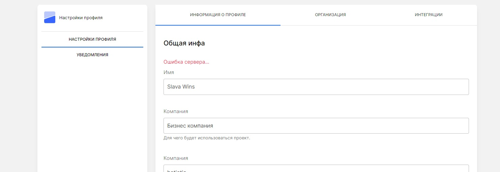

<p align="center">

</p>

## MrpProfile

Кароч изи пакет

## Установка из composer

```  
composer require slavawins/mrp-profile
```

Опубликовать js файлы, вью и миграции необходимые для работы пакета.
Вызывать команду:

```
php artisan vendor:publish --provider="MrpProfile\Providers\MrpProfileServiceProvider"
``` 

В роутере routes/web.php добавить

 ```
    Route::get('/profile', [\App\Http\Controllers\MrpProfile\UserMrpProfile::class, 'index'])->name('profile');
    Route::post('/profile/update_profile', [\App\Http\Controllers\MrpProfile\UserMrpProfile::class, 'update_profile'])->name('profile.update_profile');
    Route::post('/profile/profile_notify_if', [\App\Http\Controllers\MrpProfile\UserMrpProfile::class, 'profile_notify_if'])->name('profile.profile_notify_if');
    Route::post('/profile/profile_notify_type', [\App\Http\Controllers\MrpProfile\UserMrpProfile::class, 'profile_notify_type'])->name('profile.profile_notify_type');
    Route::post('/profile/industry', [\App\Http\Controllers\MrpProfile\UserMrpProfile::class, 'profile_industry'])->name('profile.industry');

 ```

В пользвоателя добавить. В PropertiesSetting. Это наборы всяких полей. Чтоб больше крутилок было.

 ```
        MrpProfileLibary::ExtendUser($config);
        MrpProfileLibary::ExtendUserProjectNotify($config);
 
 ``` 

Обновить поля пользователя

 ```
 php artisan mrp:migration User
 php artisan migrate
 
 ``` 

Переходим по адресу профиля, и смотрим как вкладки генерятся

 ```
/profile
 
 ``` 


## Документация

Генерирует страницу «Настройки профиля» с вкладками. Каждая вкладка — это форма полей модели `MPModel` с определённым тегом, которая сохраняется ajax-запросом.

### Установка
```
php artisan vendor:publish --provider="MrpProfile\Providers\MrpProfileServiceProvider"
```
Публикуются `app/Http/Controllers/MrpProfile/UserMrpProfile.php`, `app/Library/MrpProfile/MrpProfileLibary.php` и `resources/views/mrp-profile/index.blade.php`.

Роуты (внутри `auth`):
```php
Route::get('/profile', [UserMrpProfile::class, 'index'])->name('profile');
Route::post('/profile/update_profile', [UserMrpProfile::class, 'update_profile'])->name('profile.update_profile');
Route::post('/profile/industry', [UserMrpProfile::class, 'profile_industry'])->name('profile.industry');
Route::post('/profile/profile_notify_if', [UserMrpProfile::class, 'profile_notify_if'])->name('profile.profile_notify_if');
Route::post('/profile/profile_notify_type', [UserMrpProfile::class, 'profile_notify_type'])->name('profile.profile_notify_type');
```
В `User::PropertiesSetting()`:
```php
MrpProfileLibary::ExtendUser($config);              // companyName, Industry, industry_role, language …
MrpProfileLibary::ExtendUserProjectNotify($config); // настройки уведомлений
```
Затем `php artisan mrp:migration User && php artisan migrate`.

### Построение страницы
```php
$page = PageBuilder::New($user);
$page->name = 'Настройки профиля';
$page->AddRow('Профиль');                         // группа вкладок в сайдбаре
$page->SetRowDescription('…');  $page->SetRowIcon('/img/x.png');
$page->AddTab('Основное')
     ->SetTag('profile')                          // какие поля выводить
     ->SetAjax(true)->SetRoute(route('profile.update_profile'))
     ->SetTitle('Общая инфа')->SetButtonText('Сохранить');
return view('mrp-profile.index', ['item' => $user, 'page' => $page]);
```
Ещё у `Tab`: `SetLabel`, `SetCustomTabLabel`, `SetTabDescription`, `SetShortDescription`, `SetBeforeDescription`, `SetAfterDescription`, `SetIcon`, `SetHeaderBackground`. Через `$tab->view = '...'` можно подставить свою вьюху вместо формы.

### Обработчик вкладки
```php
$result = Auth::user()->ValidateAndFilibleByRequest($request->toArray(), 'profile');
return $result === true ? ResponseApi::Successful() : ResponseApi::Error($result);
```
Тег всегда задаётся **в коде**, его нельзя брать из запроса.

Зависимости: `slavawins/mrproperter`, `formbuilder`, `easyapi`.
